# Walkthrough: Làm lại giao diện portal — xanh Lá dịu, shadcn gốc, cấu trúc theo Vinmec (PORTAL-UI-SHADCN-001)

> **Cách góp ý:** bôi đen chữ → **Comment**, gõ góp ý; xong bấm **Send** (hoặc gõ thẳng vào ô "Message to agent"). Mình sửa file, trang tự tải lại.
> Ổn hết thì gõ **duyệt** vào ô message rồi Send — mình tự chạy duyệt và bắt đầu bước 1.

* **Nhánh:** `feat/portal-ui-shadcn` (duy nhất, tách từ `main` 767b6a7) · worktree `ticket/.cache/worktrees/portal-ui-shadcn`
* **Plan máy đọc:** [plan.md](plan.md) · **Kiểm kê UI:** [kiem-ke-261105-1423-portal-ui-rebuild-report.md](../../../../../../plans/reports/kiem-ke-261105-1423-portal-ui-rebuild-report.md)
* **Mẫu cấu trúc:** repo Vinmec, bản clone ở `ticket/.cache/refs/vinmec/apps/web`

---

## 0. Dọn nhánh trước, chỉ còn `main` + 1 nhánh UI

> Theo comment của Dawn 05/11: "chuẩn hoá hết về 1 nhánh UI để làm đã, không để các nhánh nổ ra nhiều".

**Hiện trạng portal:** 18 nhánh local, 18 worktree, 6 nhánh trên GitHub. 16/18 worktree còn file chưa commit. 7 nhánh "nogit" không còn chung gốc với `main` (lịch sử đã viết lại), 4 nhánh trong số đó là worktree của Orca.

**Cách làm — không mất gì:**
1. Mỗi worktree có file chưa commit → commit `wip: lưu trữ 05/11` ngay trên nhánh đó.
2. Gói **toàn bộ** nhánh (local + GitHub) vào 1 file `ticket/.cache/branch-archive/portal-2026-11-05.bundle` + 1 bảng `INDEX.md` (tên nhánh → commit → worktree cũ). Lấy lại bất kỳ nhánh nào: `git fetch <bundle> <nhánh>`.
3. Gỡ 17 worktree, xoá 17 nhánh local, xoá 6 nhánh GitHub.
4. Checkout chính `ticket/portal` (đang ở `fix/portal-activate-inbound-261031`, 28 file sửa) → về `main`.
5. Kết quả: `main` + `feat/portal-ui-shadcn`. Kiểm: `git branch -a` chỉ còn 2 dòng + `origin/main`.

| Nhánh | Hơn main | Worktree | File chưa commit | Lần cuối | Xử lý |
|---|---|---|---|---|---|
| `fix/portal-activate-inbound-261031` | 0 | `ticket/portal` (chính) | 28 | 5 ngày | lưu → về main |
| `test/portal-e2e-record` | 0 (đã merge) | .cache/worktrees | 20 | hôm nay | lưu → xoá |
| `docs/portal-e2e-s0` | 0 | .cache/worktrees | 1 | 5 ngày | lưu → xoá |
| `feat/portal-inbound-receive` | 0 | .cache/worktrees | 1 | 5 ngày | lưu → xoá |
| `fix/portal-activate-port` | 0 | .cache/worktrees | 1 | 5 ngày | lưu → xoá |
| `fix/portal-dish-guard` | 0 | .cache/worktrees | 1 | 5 ngày | lưu → xoá |
| `fix/portal-inbound-s5b` | 0 | .cache/worktrees | 1 | 5 ngày | lưu → xoá |
| `portal-account-edit-001` (+ GitHub) | **1** | .cache/worktrees | **45** | 10 ngày | lưu → xoá ⚠️ việc dở: sửa tài khoản, chưa e2e |
| `dawnmoriaty/portal-activate-001` | lịch sử cũ | ~/orca | 33 | 4 tuần | lưu → xoá |
| `dawnmoriaty/portal-shell-001-review-and-ship` | lịch sử cũ | ~/orca | 89 | 5 tuần | lưu → xoá |
| `dawnmoriaty/e2e-001` | lịch sử cũ | ~/orca | 20 | 4 tuần | lưu → xoá |
| `dawnmoriaty/flow-001` | lịch sử cũ | ~/orca | 9 | 4 tuần | lưu → xoá |
| `dawnmoriaty/portal-ui-bakeoff-agy` | lịch sử cũ | ~/orca | 4 | 4 tuần | lưu → xoá |
| `dawnmoriaty/portal-ui-bakeoff-codex` | lịch sử cũ | ~/orca | 4 | 4 tuần | lưu → xoá |
| `catalog-public-001` | lịch sử cũ | ~/wt | 2 | 4 tuần | lưu → xoá |
| `portal-ui-f1` | lịch sử cũ | ~/wt | 7 | 4 tuần | lưu → xoá |
| `portal-vercel-ci` | lịch sử cũ | ~/wt | 0 | 2 tuần | lưu → xoá |
| GitHub: `fooddev-set-001`, `portal-catalog-split-001`, `portal-motion-001`, `supplier-contract-001`, `vercel-no-standalone` | 0 (đã merge) | — | — | 9–14 ngày | lưu → xoá |

**Cần Dawn chốt 1 điểm:** `portal-account-edit-001` là việc dở thật (1 commit + 45 file). Mình đề xuất **lưu vào bundle rồi xoá**, khi nào làm lại thì lấy ra thành task riêng trên main mới. Không ưng thì comment "giữ account-edit".

**Ngoài portal (chưa đụng, báo để biết):** inventory và production đang có Antigravity sửa thẳng trên `main` (17 và 4 file) cho COST-PRICE-LINK-001. Đề xuất: khi nó xong thì chuyển sang nhánh `fix/cost-price-link` có sẵn, không commit thẳng main.

---

## 1. Bối cảnh & Mục tiêu

* **Vấn đề hiện tại:**
  * Màu đỏ cam đất `#D2402A` nằm ở **2 hệ màu chạy song song** (`app/tokens.generated.css` và hệ `--p` cũ trong `app/globals.css`), cộng **62 chỗ** gõ cứng tên màu.
  * `components/ui/` là **19 component tự viết**, không phải shadcn: Button 73 chỗ dùng, hộp thoại tự viết 403 dòng, Checkbox và ô nhập mỗi thứ 2 bản, 1 component + 4 modal không ai dùng.
  * Thư mục lộn xộn: 2 thư mục e2e, contracts ở 2 nơi, form đăng nhập khách/nhân viên gần trùng nhau, `roles-view.tsx` 528 dòng.
* **Mục tiêu:**
  1. Toàn portal dùng **1 bộ màu** Lá dịu, sinh từ 1 nguồn.
  2. `components/ui/` = **shadcn gốc từ CLI, không sửa tay**. Bản custom đặt riêng ở `components/patterns/`, bọc bản gốc.
  3. Cấu trúc thư mục + luật theo Vinmec, có script tự chặn code đặt sai chỗ.
  4. Mỗi vai đi hết hành trình của mình trên giao diện mới — **bạn xem video từng vai rồi mới merge**.

```mermaid
flowchart LR
    A[Video trước<br/>5 vai] --> B[Màu Lá dịu]
    B --> C[Dựng shadcn]
    C --> D[Thay component<br/>3 đợt]
    D --> E{{Dawn chọn<br/>bố cục}}
    E --> F[Khung console<br/>cửa hàng, đăng nhập]
    F --> G[Dọn thư mục<br/>theo Vinmec]
    G --> H[Kho] --> I[QC] --> J[FOOD_DEV] --> K[Quản trị] --> L[Khách]
    L --> M{{Dawn xem đủ video}} --> N[Merge main]
```

---

## 2. Màu Lá dịu (đã chốt 05/11)

| Vai trò | Mã | Dùng cho |
|---|---|---|
| primary | `#2E9B5F` | nút chính, mục menu đang chọn |
| primary-hover | `#237A4A` | hover nút chính |
| primary-soft | `#E3F4EA` | nền nhãn "đủ/đã nhập", nền mục menu đang chọn |
| primary-ink | `#1D5E3A` | chữ trên nền soft |
| nền / chữ / viền | zinc-50 · zinc-900 · zinc-200 | toàn bộ màn |
| lỗi | red-600 | chỉ lỗi và nút xoá |

Đổi ở **1 chỗ**: `platform-docs/ui/tokens.json` → `uigen.py` sinh ra `app/tokens.generated.css` theo tên biến của shadcn (`--primary`, `--muted`, `--border`…). Hệ `--p` cũ bị xoá. 3 test đang khoá màu đỏ (`app/rebrand.test.ts`, `app/theme.test.tsx`, `app/layout-gate.test.ts`) được sửa kỳ vọng, không xoá test.

---

## 3. Nút và component: shadcn gốc

Giao diện tham chiếu là **bản shadcn thật**, không phải mẫu vẽ tay:
* Nút: https://ui.shadcn.com/docs/components/button
* Khung console (sidebar thu gọn): https://ui.shadcn.com/blocks/sidebar — mẫu `sidebar-07`
* Bảng + bộ lọc: https://ui.shadcn.com/blocks — mẫu `dashboard-01`

| Thay | Bằng shadcn | Bản riêng (patterns/) |
|---|---|---|
| button.tsx (73 chỗ dùng) | Button | `action-button.tsx`: nút có "đang lưu…" + báo lỗi |
| input, field, label, checkbox, switch | Input, Label, Checkbox, Switch | `password-input.tsx` (đã có) |
| card, badge, table, tabs, state | Card, Badge, Table, Tabs, Skeleton, Tooltip | `status-badge.tsx`: trạng thái phiếu/lô → màu · `empty-state.tsx` |
| dialog.tsx (403 dòng), popover, toast | Dialog, Sheet, Popover, Select, DropdownMenu, Command, Sonner | `confirm-dialog.tsx` · `entity-picker.tsx` |
| switch.tsx, 4 modal không ai dùng, Checkbox/ô nhập trùng | — | **xoá** |

> Bước "Chọn bố cục" (mục 5): mình chụp **ảnh màn portal thật** sau khi đã thay component, 2–3 phương án khung, để bạn chọn. Không vẽ mẫu tay nữa.

---

## 4. Học gì từ Vinmec

| Lấy | Không lấy |
|---|---|
| `app/` chỉ trang + kiểm quyền; `features/<domain>/` nghiệp vụ; `lib/` gọi API + contract | Kit của Vinmec — chỉ Button là shadcn chuẩn, còn lại tự viết |
| Hook `use-*.ts` giữ logic/điều hướng, `.tsx` chỉ hiển thị | Màu hex gõ cứng trong CSS |
| Không có `index.ts` gom export | Bỏ SWR để tự viết hook tải dữ liệu |
| Script `check-structure` chặn: `fetch` ngoài `lib/`, bảng/hộp thoại/ô chọn thô ngoài `components/ui`, `useRouter` trong `.tsx` | Thư mục `src/` (xem quyết định D2) |

---

## 5. Các bước

Mỗi bước = 1 commit trên nhánh `feat/portal-ui-shadcn`. Codex code, mình review diff + chạy kiểm tra. 🎬 = bạn xem video trước khi qua bước sau.

| # | Bước | Việc chính | Kiểm |
|---|---|---|---|
| S0 | Video "trước" | quay 5 hành trình trên main để so | 🎬 |
| S1 | Màu Lá dịu | tokens.json → uigen → biến shadcn, gộp hệ `--p`, sửa 3 test màu | `grep D2402A` = 0 |
| S2 | Dựng shadcn | `components.json`, Radix chỉ cho `components/ui` | lint + build |
| S3a | Nút, ô nhập | Button, Input, Label, Checkbox, Switch + `action-button` | vitest |
| S3b | Thẻ, bảng, nhãn | Card, Badge, Table, Tabs… + `status-badge`, `empty-state` | vitest |
| S3c | Hộp thoại, menu | Dialog, Sheet, Select, Sonner… + `confirm-dialog`, `entity-picker`; xoá kit cũ thừa | vitest |
| S4a | **Bạn chọn bố cục** | 2–3 ảnh chụp màn thật | 💬 bạn chọn |
| S4b | Khung console | sidebar thu gọn, đường dẫn, tiêu đề trang; điện thoại: ngăn kéo | 🎬 1280 + 375px |
| S4c | Cửa hàng + đăng nhập | khách và nhân viên dùng chung 1 khung đăng nhập | 🎬 |
| S5 | Dọn thư mục | gộp e2e, gộp contracts, tách `roles-view.tsx`, thêm `check-structure` | script xanh |
| S6 | Vai **kho** | NCC, phiếu nhập, nhận hàng có ảnh, tồn kho | 🎬 |
| S7 | Vai **QC** | QC đầu vào, QC thành phẩm, truy xuất | 🎬 |
| S8 | Vai **FOOD_DEV** | món, nguyên liệu, giá vốn, mở bán | 🎬 |
| S9 | Vai **quản trị** | chi nhánh, nhân sự, vai trò, công ty | 🎬 |
| S10 | Vai **khách** | cửa hàng, giỏ, đăng nhập, kích hoạt | 🎬 |
| S11 | Dọn cuối | xoá kit cũ sót, co baseline, chạy toàn bộ kiểm tra | tất cả xanh |

**Giữ cho dự án không phình:**
* 1 nhánh, 1 worktree. Không mở nhánh phụ cho từng bước.
* Mỗi bước chỉ sửa file đã liệt kê trong [plan.md](plan.md), máy kiểm sẽ chặn file ngoài danh sách.
* Không thêm thư viện nào ngoài shadcn + Radix + sonner + lucide (đã có).
* Merge xong là xoá nhánh và worktree.

---

## 6. Quyết định mình đã chọn sẵn

| | Câu hỏi | Mình chọn | Lý do |
|---|---|---|---|
| D1 | Mở Radix (shadcn cần) | **chỉ cho `components/ui/`** | màn hình/nghiệp vụ vẫn bị cấm, phải đi qua component |
| D2 | Chuyển sang `src/` như Vinmec | **không** | đổi đường dẫn import toàn repo, lợi ích ít |
| D3 | Nâng next/react/zod ngang Vinmec | **task riêng sau** | gộp vào sẽ lẫn lỗi nâng cấp với lỗi giao diện |

---

## 7. Rủi ro

| Rủi ro | Xử lý |
|---|---|
| Thay Button đổi hàng trăm import một lượt | commit riêng, dễ revert, chạy vitest + build ngay |
| Radix làm nặng trang | đo `next build` trước/sau ở S2, ghi số vào đây |
| Đổi tokens.json chạm repo platform-docs | nhánh cùng tên ở platform-docs, merge cùng lúc |

---

## 💬 Góp ý của Dawn

<!-- gõ "> 💬 ..." bên dưới -->
